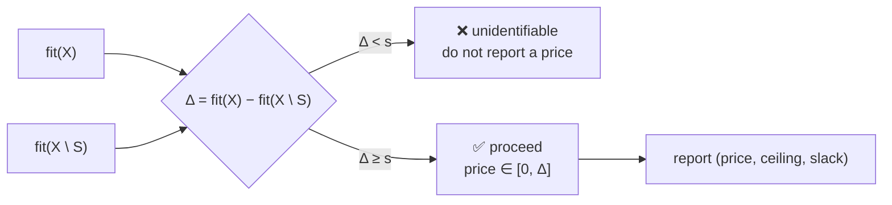

<div align="center">

# 🔥 The Cost of a Physics Prior Is Bounded by the Ablation Gap

[](LICENSE)
[](https://www.python.org/)
[](#-reproduce)
[](#-headline-result)
[](#-headline-result)

**[TL;DR](#-tldr) · [Result](#-headline-result) · [Findings](#-findings) · [Screen](#-screen-before-you-run) · [Reproduce](#-reproduce) · [Repo](#-repo-map) · [Scope](#-scope) · [Cite](#-citation)**

</div>

---

> [!IMPORTANT]
> **A constrained model must never be beaten by its own ablation.**

## ⚡ TL;DR

A shape constraint on features `S` cannot cost more than `S` is worth. Ignoring `S` always satisfies the constraint, because a function that is constant in `x_j` is both non-decreasing and non-increasing in `x_j`. So for any risk functional:

$$
0 \;\le\; P(\sigma) \;\le\; \Delta(S)
$$

This needs no convexity, smoothness or realizability assumption. In practice it comes down to one sign check on a column you already have:

```text
F1(constrained)  >=  F1(ablated)
```

**Consequence:** the range of a reported "cost of physics" is set by the free features and the validation split, not by the physics. We measure this on an ordinal wildfire-severity task (`N = 26,681`, `K = 3`, four monotone drivers).

<details>
<summary><b>📐 Why the bound holds (one line)</b></summary>

<br>

Function classes nest: models that ignore `S` ⊆ models monotone in `S` ⊆ unconstrained models. Every arm uses the same learner, so the best achievable score is ordered the same way:

$$
F_1(\texttt{MC}) \;\ge\; F_1(\texttt{MONO}) \;\ge\; F_1(\texttt{ablated})
$$

Subtracting gives `P = F1(MC) − F1(MONO) ∈ [0, Δ]` with `Δ = F1(MC) − F1(ablated)`. Fitted out-of-fold estimates can fall outside this interval by finite-sample noise. That noise is what the floor `s` measures (see [Findings](#-findings)).

</details>

---

## 📊 Headline result

Out-of-fold macro-F1 from `results/ctx/`.
`Δ = MC − GEO_ONLY` is the **certified ceiling** on the cost of any monotone prior. `P = MC − MONO_sc` is the **measured price**.

| protocol | `GEO_ONLY` | `MC` | `MONO_sc` | **`Δ`** (ceiling) | **`P`** (price) | `P / Δ` |
|:--|--:|--:|--:|--:|--:|--:|
| `iid`     | 0.7028 | 0.8316 | 0.7843 | **0.1288** | **0.0473** | 0.37 |
| `point`   | 0.7146 | 0.8311 | 0.7755 | **0.1165** | **0.0556** | 0.48 |
| `spatial` | 0.5602 | 0.6029 | 0.5850 | **0.0427** | **0.0179**\* | 0.42 |

<sub>\* Below the self-calibrated floor <code>s = 0.0220</code>, so this value carries no interpretation.</sub>

---

## 🔎 Findings

> [!NOTE]
> **🛡️ Coordinates shield the prior.**
> Under spatial blocking, `{lat, lon}` alone recover **92.9%** of the full model (`0.5602 / 0.6029`). The same screened prior costs `0.0473` when shielded and `0.3470` when unshielded (`PHYS_sc` vs `WX_ONLY`). That is a **7.3×** swing from identical physics.

> [!WARNING]
> **🔀 Prices do not transfer.**
> Coarsening the blocks from 1° to 10° moves `Δ` from `0.0942` to `0.0050` and the price from `+0.0456` to `−0.0139`. The sign flips because of the split alone. Both 10° values are smaller in magnitude than `s`, so the negative price is noise and does not break the bound.

> [!TIP]
> **📏 A free noise floor.**
> Of **318** orderings the pipeline must satisfy, **18** invert, which gives `s = 0.0220`. Before any constrained model is trained, this floor voids **4 of 21** price cells and **10** grid cells.

> [!CAUTION]
> **⚖️ Cost and compliance are independent.**
> The unconstrained model violates the textbook prior at a rate of **0.48**. Enforcing the prior costs **0.02**.

---

## 🧪 Screen before you run

Two unconstrained fits tell you whether a constrained experiment can identify anything at all. You don't need a constrained solver for this step.



```python
def admissible(fit, X, y, S, protocol, s_hat):
    """Two unconstrained fits. No constrained solver required."""
    delta = fit(X, y, protocol) - fit(X.drop(columns=S), y, protocol)
    if delta < s_hat:
        return f"unidentifiable: Delta={delta:.4f} < s={s_hat}"
    return f"proceed; any price on S lies in [0, {delta:.4f}]"
```

---

## 🚀 Reproduce

```bash
python -m venv venv && source venv/bin/activate
pip install -r requirements.txt

./run.sh ctx      # headline config: 2° blocks, gate auto/fold
./run.sh grid     # all nine configurations
./run.sh digest   # results/*/  ->  digest_all.txt
```

<details>
<summary><b>🗂️ Configuration grid (9 configs)</b></summary>

<br>

| tag | purpose |
|:--|:--|
| `ctx` | **headline**: 2° spatial blocks |
| `b1` · `b2` · `b5` · `b10` | block-size sweep (1°, 2°, 5°, 10°) |
| `closed` | exogeneity gate shut |
| `drv` | five constrained drivers (`\|S\| = 5`) |
| `glob` | leak probe |
| `k5` | `K = 4` severity classes |

`ctx`, `b2` and `glob` produce byte-identical outputs.

</details>

<details>
<summary><b>⚙️ Shared architecture (all 11 arms)</b></summary>

<br>

| hyperparameter | value |
|:--|--:|
| iterations | 300 |
| learning rate | 0.06 |
| max leaves | 31 |
| min samples / leaf | 40 |
| L2 regularization | 1.0 |
| seed | 0 |

Arms differ **only** in feature set and monotonicity spec. This makes the class nesting exact, and no penalty weight is tuned.

</details>

---

## 🧭 Repo map

| path | contents |
|:--|:--|
| `src/mib_study.py` | entrypoint: 11 arms × 3 protocols × 5 folds, seed 0 |
| `src/mib_models.py` | cumulative ordinal HGB ensemble with hard monotone split constraints |
| `src/mib_data.py` | loading, filtering, spatial blocking |
| `src/mib_audit.py` | falsifiers C1–C6, violation rates, exogeneity gate |
| `src/mib_digest.py` | results → manuscript tables |
| `src/mib_figures_paper.py` | figures written to `paper/figs_ctx/` |
| `results/<tag>/`, `logs/` | per-configuration artefacts and full run logs |

**Arms:** `MAJORITY` · `GEO_ONLY` · `WX_ONLY` · `MC` · `MONO_naive` · `MONO_sc` · `PHYS` · `PHYS_sc` · `MIB` · `MIB_fp` · `MIB_fm`

| symbol | features |
|:--|:--|
| drivers `D` | `temp`, `rh`, `wind`, `precip` |
| shield `G` | `lat`, `lon` |
| auxiliary channel | residualized insolation |

---

## 🎯 Scope

This is **not** a new algorithm. It is also **not** a claim that shape constraints are useless: they buy extrapolation and auditability, which no in-distribution metric measures. The 92.9% shield comes from latitude and longitude, which carry no mechanism and can't be evaluated outside the sampled domain.

The claim is narrower:

> **In-distribution accuracy cost is the wrong instrument for evaluating a physical prior.**
> Report the triple **`(price, ceiling, slack)`** together with the free feature set.

---

## 📚 Citation

```bibtex
@article{kriuk2026ablationgap,
  title  = {The Cost of a Physics Prior Is Bounded by the Ablation Gap},
  author = {Kriuk, Boris},
  year   = {2026}
}
```

Corpus and meteorological joins: [`arXiv:2502.17023`](https://arxiv.org/abs/2502.17023).

<div align="center">
<sub>Licensed under <a href="LICENSE">Apache-2.0</a> · built with 🐍 Python 3.10+ · fully reproducible at seed 0</sub>
</div>
